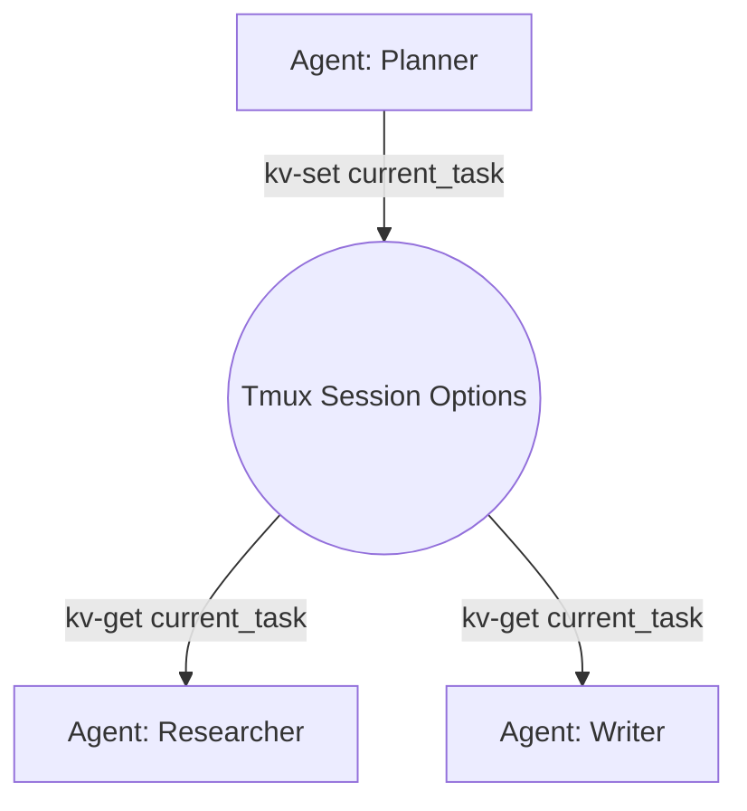
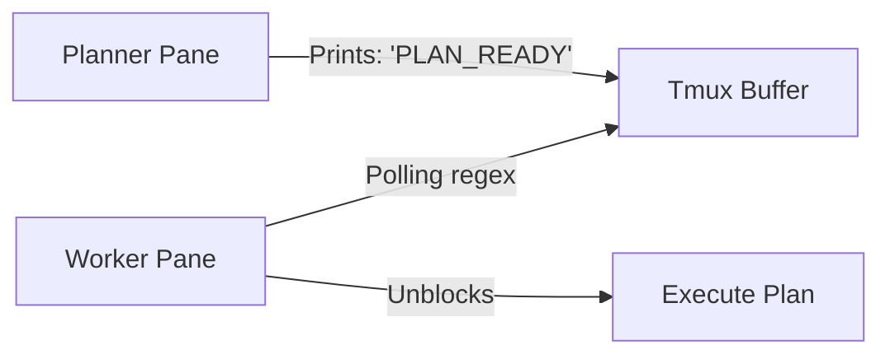
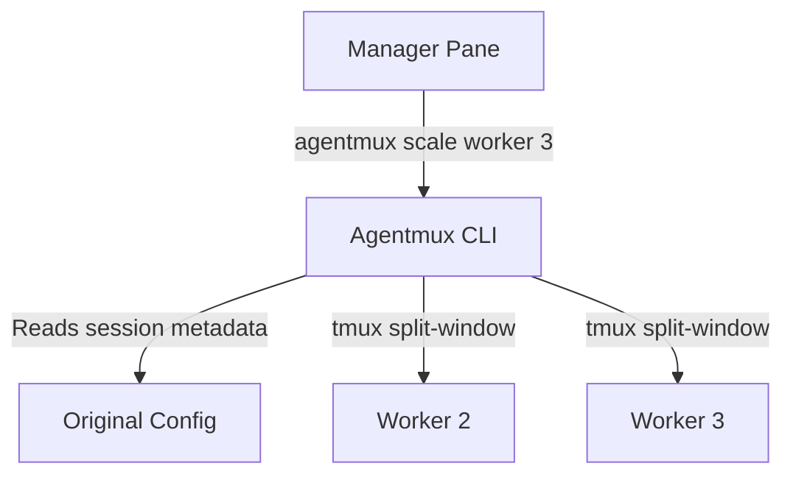

# Agentic Coordination

The transition from a "Terminal Window Manager" to an "Agentic Platform" requires primitives that allow isolated terminal processes to talk to each other.

Agentmux achieves this using two native primitives: **The Blackboard** and **The Wait**.

## 1. The Blackboard (KV-Store)

If five agents are working in five different tmux panes, they need a "Shared Brain" to store state (e.g., "What is the current sub-task?"). 

Instead of running a Redis or SQLite database, Agentmux uses **Tmux Session Options**.

Any pane can run `agentmux kv-set my-session key "value"` to write, and any other pane can run `agentmux kv-get my-session key` to read. 

*   **Stateless:** If Agentmux crashes, the data survives in tmux.
*   **Inspectable:** You can run `agentmux kv-list` to see exactly what the team is thinking.

## 2. Synchronization (Wait)

Agents often need to block until another agent finishes a task. Rather than complex webhooks, Agentmux uses the terminal itself as the messaging bus.

The `agentmux wait` command polls a target pane's output stream. When it detects a specific regex string, it unblocks and exits with code 0.

## 3. Dynamic Scaling

When an agentic team encounters a massive task, the manager might decide to parallelize the work.

The `scale` command safely injects new panes into the running session, using the original configuration context, and automatically handles re-applying the window layout.
