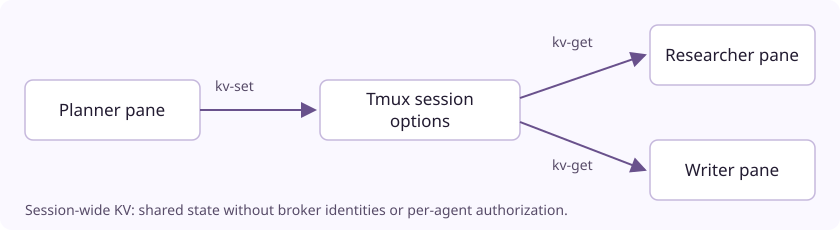
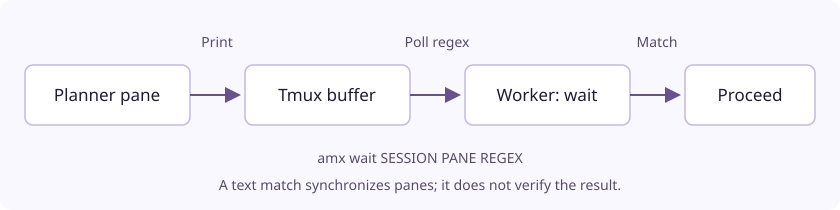
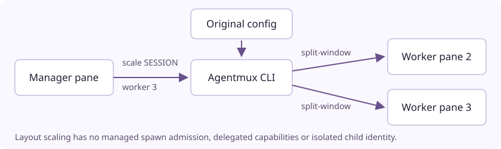

# Coordination primitives

For current interactive and managed teams, coordination goes through an
authenticated broker: scoped messages/boards, queued instructions, private and
shared memory, versioned permissions and consented teams. Start with
[work sessions](../work-sessions.md), [live permissions](../live-permissions.md)
and the [managed runtime](../managed-runtime.md). Those controls are independent
of native tool approvals and filesystem sandboxing.

The remainder of this page describes the original v1 layout mode's tmux KV,
output polling and raw pane scaling. These remain available, but do not enforce
the broker's agent identities, hierarchy or per-agent access rules. They do not
create process/filesystem isolation.

## 1. The Blackboard (KV-Store)

If five agents are working in five different tmux panes, they need a "Shared Brain" to store state (e.g., "What is the current sub-task?"). 

Instead of running a Redis or SQLite database, Agentmux uses **Tmux Session Options**.

Any pane can run `amx kv-set my-session key "value"` to write, and any other pane can run `amx kv-get my-session key` to read.

*   **Stateless:** If Agentmux crashes, the data survives in tmux.
*   **Inspectable:** `amx kv-list SESSION` shows the values that participants explicitly stored, not their private reasoning.

## 2. Synchronization (Wait)

Agents often need to block until another agent finishes a task. Rather than complex webhooks, Agentmux uses the terminal itself as the messaging bus.

The `amx wait` command polls a target pane's output stream. When it detects a specific regex string, it unblocks and exits with code 0.

## 3. Dynamic Scaling

When an agentic team encounters a massive task, the manager might decide to parallelize the work.

The legacy `scale SESSION AGENT COUNT` command adds/removes panes using the
original configuration and reapplies the window layout. Managed delegated
spawning instead requires approved templates, admission limits and broker
authority; see [dynamic teams](../dynamic-teams.md).

## 4. LLM Native Awareness

The legacy pane launcher provides these context-delivery mechanisms:

1.  **Environment Injection:** Every pane automatically receives `$AGENTMUX_SESSION` and `$AGENTMUX_PANE` environment variables.
2.  **CLI Tool Bridge:** Models call real coordination actions through `amx tool-call`, using `--from-stdin`, `--from-file`, or `--from-json`, which wraps the existing Agentmux CLI in a machine-stable JSON envelope.
3.  **Native MCP Surface:** Agentmux can expose the same coordination registry through `amx mcp-server`, allowing providers with verified MCP support to use the tools natively instead of shelling out.
4.  **Schema Export For Compatibility:** The `amx tools` command still generates provider-friendly JSON schemas (`openai`, `codex`, `gemini`, `claude`) for debugging or compatibility exports, but it is no longer the primary runtime contract.
5.  **JIT Compilation:** Using the `provider`, `persona`, and optional `reasoning_effort` fields, Agentmux compiles provider-specific CLI commands that deliver persona and operational coordination through the strongest real surfaces available, selecting `native-mcp` or `cli-bridge` per provider at launch time.

Persona delivery is intentionally provider-specific:
- Claude appends the persona and coordination instructions to Claude Code's default system prompt.
- Pi appends the persona and CLI bridge instructions to its default system prompt.
- Antigravity uses an interactive bootstrap prompt through `agy`, with the CLI bridge. Agentmux does not modify shared Antigravity MCP configuration.
- Gemini uses a native workspace context file via a session-scoped runtime artifact.
- Codex and GPTMe currently use bootstrap prompt delivery.
