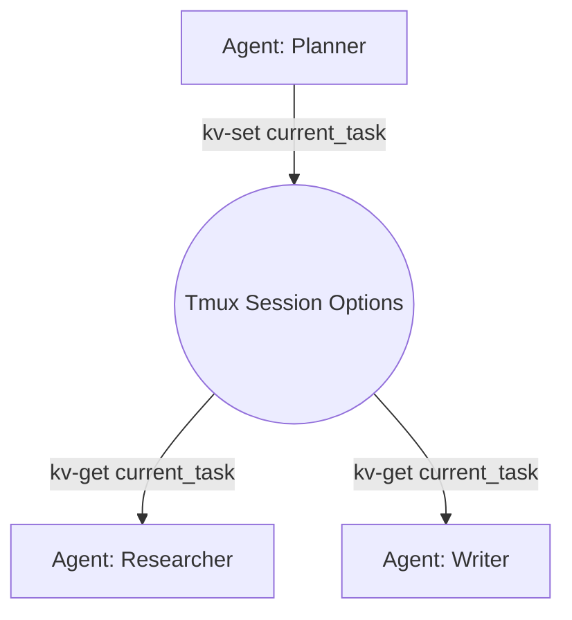
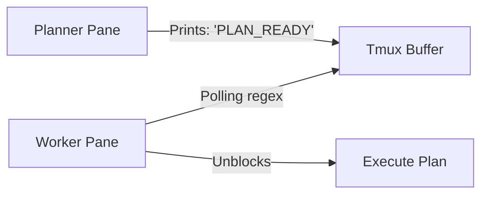
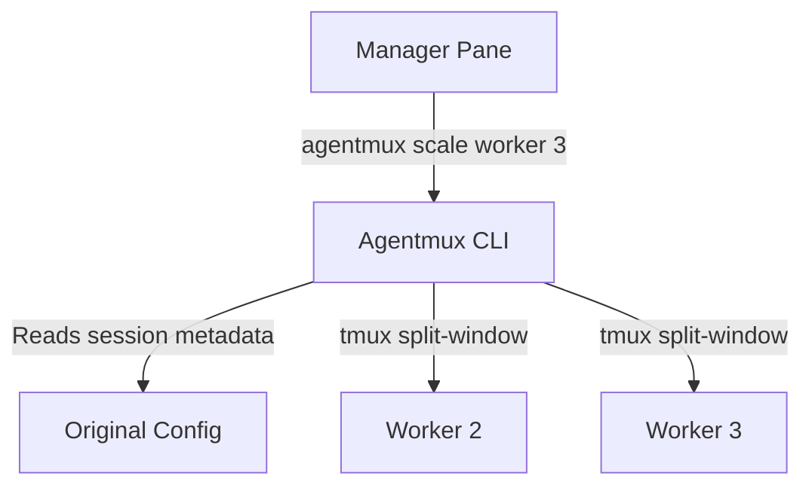

# Agentic Coordination

The transition from a "Terminal Window Manager" to an "Agentic Platform" requires primitives that allow isolated terminal processes to talk to each other.

Agentmux achieves this using two native primitives: **The Blackboard** and **The Wait**.

## 1. The Blackboard (KV-Store)

If five agents are working in five different tmux panes, they need a "Shared Brain" to store state (e.g., "What is the current sub-task?"). 

Instead of running a Redis or SQLite database, Agentmux uses **Tmux Session Options**.

Any pane can run `agentmux kv-set my-session key "value"` to write, and any other pane can run `agentmux kv-get my-session key` to read. 

*   **Stateless:** If Agentmux crashes, the data survives in tmux.
*   **Inspectable:** You can run `agentmux kv-list` to see exactly what the team is thinking.

## 2. Synchronization (Wait)

Agents often need to block until another agent finishes a task. Rather than complex webhooks, Agentmux uses the terminal itself as the messaging bus.

The `agentmux wait` command polls a target pane's output stream. When it detects a specific regex string, it unblocks and exits with code 0.

## 3. Dynamic Scaling

When an agentic team encounters a massive task, the manager might decide to parallelize the work.

The `scale` command safely injects new panes into the running session, using the original configuration context, and automatically handles re-applying the window layout.

## 4. LLM Native Awareness

For an LLM to coordinate effectively, it must "know" about these primitives and the session context. Agentmux provides five mechanisms for this:

1.  **Environment Injection:** Every pane automatically receives `$AGENTMUX_SESSION` and `$AGENTMUX_PANE` environment variables.
2.  **CLI Tool Bridge:** Models call real coordination actions through `agentmux tool-call`, using `--from-stdin`, `--from-file`, or `--from-json`, which wraps the existing Agentmux CLI in a machine-stable JSON envelope.
3.  **Native MCP Surface:** Agentmux can expose the same coordination registry through `agentmux mcp-server`, allowing providers with verified MCP support to use the tools natively instead of shelling out.
4.  **Schema Export For Compatibility:** The `agentmux tools` command still generates provider-friendly JSON schemas (`openai`, `codex`, `gemini`, `claude`) for debugging or compatibility exports, but it is no longer the primary runtime contract.
5.  **JIT Compilation:** Using the `provider`, `persona`, and optional `reasoning_effort` fields, Agentmux compiles provider-specific CLI commands that deliver persona and operational coordination through the strongest real surfaces available, selecting `native-mcp` or `cli-bridge` per provider at launch time.

Persona delivery is intentionally provider-specific:
- Claude appends the persona and coordination instructions to Claude Code's default system prompt.
- Pi appends the persona and CLI bridge instructions to its default system prompt.
- Antigravity uses an interactive bootstrap prompt through `agy`, with the CLI bridge. Agentmux does not modify shared Antigravity MCP configuration.
- Gemini uses a native workspace context file via a session-scoped runtime artifact.
- Codex and GPTMe currently use bootstrap prompt delivery.
